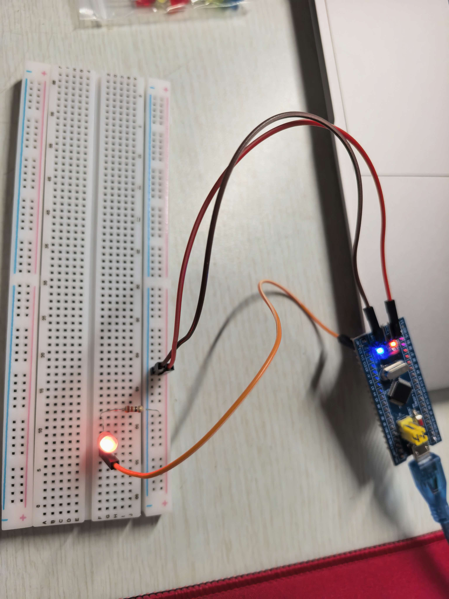
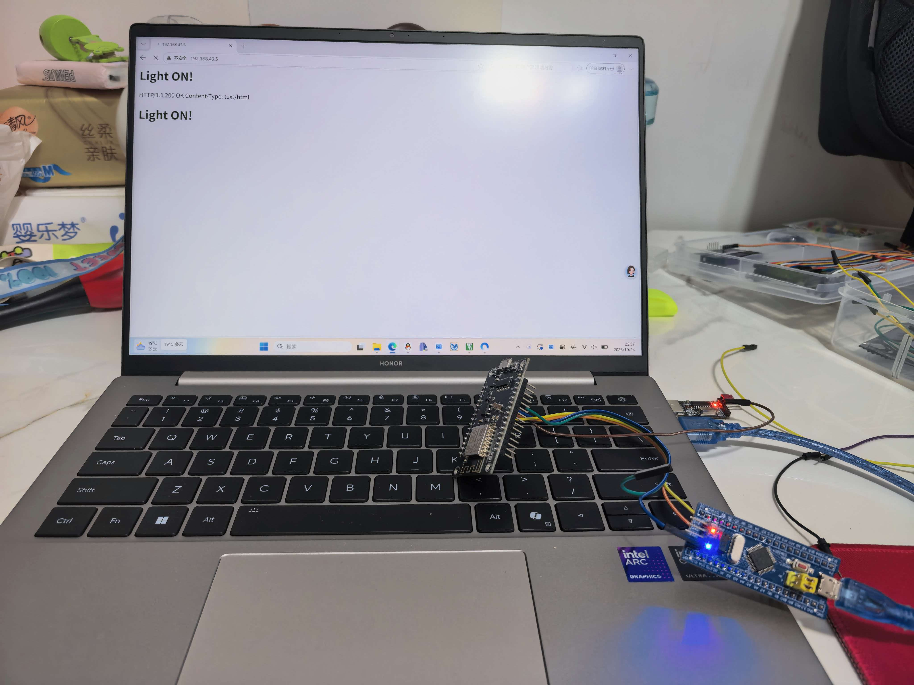
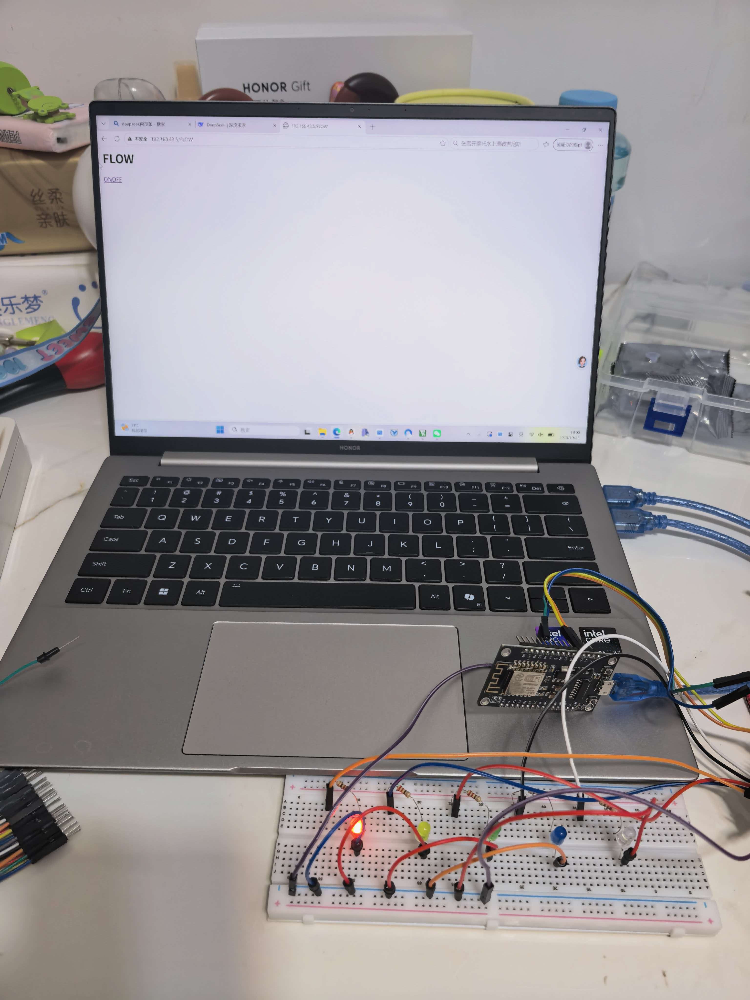
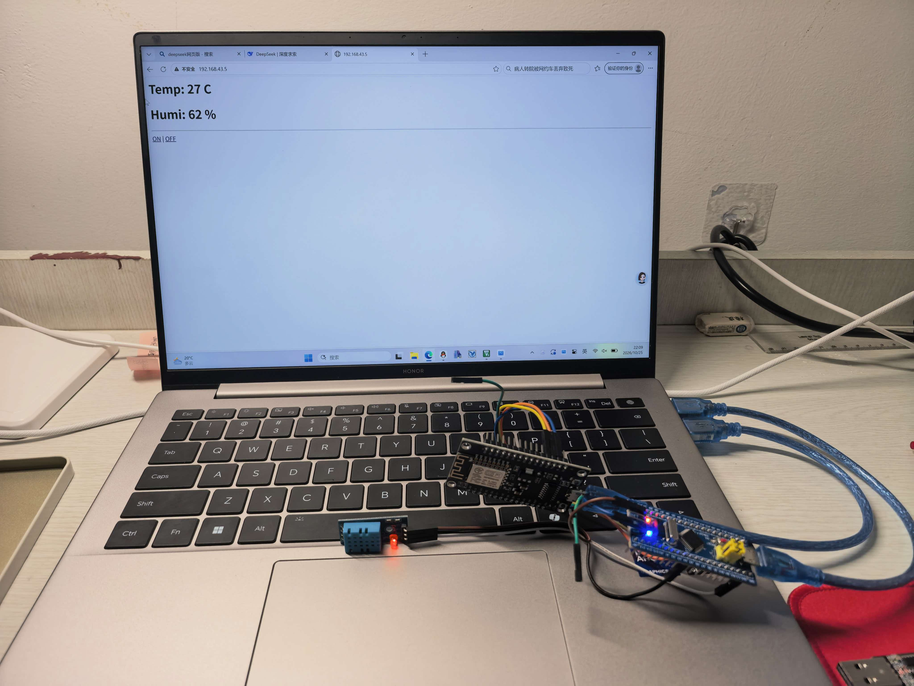

# IoT 工作室招新 - 第一轮任务提交

## 项目简介
本项目基于 **STM32F103C8T6** 主控芯片与 **ESP8266** Wi-Fi 模块，从零搭建了一个完整的物联网控制节点。从基础的 GPIO 控制到复杂的网络协议栈通信，最终实现了一个可通过手机浏览器远程控制与实时监控的 Web 服务器。

## 技术栈与核心知识点
- **硬件平台**：STM32F103C8T6, ESP8266 (NodeMCU), DHT11 温湿度传感器
- **底层驱动**：GPIO 推挽输出/输入、USART 串口通信、SysTick 滴答定时器
- **网络通信**：AT 指令集、TCP/IP 协议、HTTP 协议、HTML/CSS 基础
- **工程工具**：Git 版本控制、GitHub 仓库托管

##  任务成果展示

### 任务一：点亮第一盏灯
- **实现功能**：控制 STM32 板载 LED（PC13）闪烁，熟悉 GPIO 输出与延时函数。

### 任务二前置 & 任务二：ESP8266 自动联网与网页控灯
- **实现功能**：STM32 通过串口发送 AT 指令控制 ESP8266 连入热点，并建立 HTTP 服务器。通过手机浏览器访问 IP 地址，实现网页端对 LED 的开关控制。

### 任务三：让光流动起来（非阻塞流水灯）
- **实现功能**：利用定时器中断（TIM）实现 5 颗 LED 的流水灯效果，告别 `Delay()` 阻塞。在流水灯运行的同时，网页服务器依然能秒级响应外部请求。

### 任务四：让设备感知世界（DHT11 温湿度监控）
- **实现功能**：移植 DHT11 单总线驱动，将采集到的环境温湿度数据拼接到 HTTP 响应报文中。利用 HTML 的 `meta refresh` 标签，实现网页每 3 秒自动刷新显示最新温湿度，并保留网页控灯功能。

---
*Created by Aria-d-cmd. 期待在二轮任务中继续探索嵌入式与物联网的边界！*
